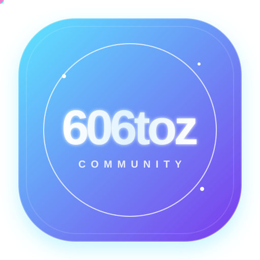

<div align="center">



<br>



# iOS 17 Launcher — **606toz Edition**

### iOS 17 look for Android. Now lighter, faster, and built for legacy devices. 🍏⚡


<br>

[](https://github.com/BassX606toz/iOS17-606toz/actions/workflows/build.yml)
[](https://developer.android.com)
[](https://www.java.com)
[](LICENSE)
[](https://github.com/BassX606toz)

</div>

---

## ✨ Apa ini?

Launcher Android dengan **nuansa iOS 17** — home screen, dock, folder, widget, blur wallpaper, dan pencarian ala iOS. Fork dari [`vednig/iOS17`](https://github.com/vednig/iOS17) yang merupakan fork dari **Bliss Launcher** (/e/ OS), yang sudah kami **optimasi ulang khusus untuk HP lawas dan low-end**.

> Tujuan: tetap cantik seperti iOS, tapi nggak bikin HP 1–2 GB RAM tersendat.

---

## ⚡ Yang bikin edisi ini beda

| Optimasi | Sebelum | Sesudah |
|---|---|---|
| **Min SDK** | 27 (Android 8.1) | **23 (Android 6.0)** ✅ |
| **R8 + resource shrinking** | ❌ Mati | ✅ Aktif di release |
| **Desugaring + `Stream`** | Aktif | Dihapus (diganti loop) |
| **RenderScript support lib** | Aktif (padahal unused) | Dihapus |
| **Telemetry / Sentry** | Aktif | Dihapus |
| **Dependency unused** | EventBus, Apache Commons, RestrictionBypass, ProfileInstaller, Telemetry | Bersih |
| **Blur di HP low-RAM** | Selalu jalan | **Auto-off** + placeholder 1×1 |
| **Bahasa dikemas** | Semua locale | Bisa dibatasi (`resConfigs`) |

### 🧠 Auto lite-mode

Deteksi perangkat low-end terjadi otomatis lewat `ActivityManager.isLowRamDevice()` atau heap maksimal < 96 MB:

```java
public static boolean isLowMemoryDevice(Context context) {
    ActivityManager am = (ActivityManager) context.getSystemService(Context.ACTIVITY_SERVICE);
    if (am == null) return false;
    if (Build.VERSION.SDK_INT >= 19 && am.isLowRamDevice()) return true;
    return Runtime.getRuntime().maxMemory() < 96L * 1024L * 1024L;
}
```

Saat terdeteksi low-RAM: blur wallpaper dimatikan, drawable/listener blur nggak dibuat, dan placeholder cukup **1 pixel** — jauh lebih hemat heap & CPU. Di perangkat yang lebih kuat, efek blur iOS tetap hidup.

Rincian lengkap ada di [`OPTIMIZATIONS.md`](OPTIMIZATIONS.md).

---

## 🎯 Fitur

- 🏠 Home screen & dock bergaya iOS 17
- 📁 Folder dengan animasi halus
- 🧩 Widget Android (AppWidgetHost)
- 🔍 Pencarian app + suggestion online (DuckDuckGo / Qwant)
- 🌤️ Weather & notifikasi badge
- 🎨 Icon pack adaptive
- 🌙 Blur wallpaper dinamis (auto-off di low-end)
- ⌨️ Gesture & drag-drop

---

## 🛠 Build

Butuh **Android Studio / Android SDK** + **JDK 11** (AGP 7.3.1).

```bash
git clone https://github.com/BassX606toz/iOS17-606toz.git
cd iOS17-606toz
./gradlew assembleApiQRelease
```

Output APK: `app/build/outputs/apk/apiQ/release/`

### Opsi tambahan

Buat memperkecil APK, tambahkan di `local.properties`:

```properties
resConfigs=en,id
```

### Flavor yang tersedia

| Flavor | Keterangan |
|---|---|
| `apiQ` | LineageOS / Android Q SDK jar |
| `apiR` | LineageOS / Android R SDK jar |
| `apiS` | /e/ OS Android S SDK jar |

> ⚠️ Karena launcher ini memakai API sistem & hidden API (lewat Refine), pemasangan sebagai system app / dengan permission platform akan memberikan hasil terbaik.

---

## 🤖 CI & Release otomatis

GitHub Actions ([`.github/workflows/build.yml`](.github/workflows/build.yml)) jalan otomatis:

- **Push ke `master` / Pull Request** → build ke-3 flavor + upload APK sebagai artifact.
- **Tag `v*`** (misal `v1.16.0`) → build + **bikin GitHub Release** dan lampirkan semua APK.

```bash
git tag v1.16.0
git push origin v1.16.0
```

---

## 📲 Install

1. Build APK release atau ambil dari menu **Releases**.
2. Install di perangkat (`adb install app-....apk`).
3. Saat tombol Home ditekan, pilih launcher ini sebagai **default**.

---

## 🤝 606toz Community

Dibangun dan dioptimasi oleh **606toz Community**.

- 👤 Maintainer: [@BassX606toz](https://github.com/BassX606toz)
- 💬 Diskusi & issue: [GitHub Issues](https://github.com/BassX606toz/iOS17-606toz/issues)
- ⭐ Kalau berguna, jangan lupa kasih **star** — itu bikin kami makin semangat!

<p align="center">
  
</p>

---

## 🙏 Credits

- [vednig/iOS17](https://github.com/vednig/iOS17) — fork asli iOS 17 launcher
- [Bliss Launcher](https://gitlab.e.foundation/e/os/BlissLauncher) — upstream oleh /e/ OS
- Seluruh kontributor open-source di balik library yang dipakai

## 📄 License

Proyek ini mengikuti lisensi **GPL-3.0** — lihat [`LICENSE`](LICENSE).

<div align="center">

**Made with 💜 by 606toz Community**
<i>“Ringan di HP lawas, tetap terasa iOS.”</i>

</div>
